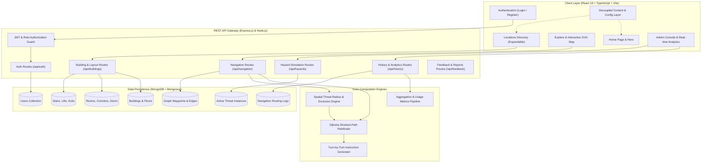

# 🧭 IndoorNav — Complete Technical & Functional Documentation

> **A Full-Stack Campus Indoor Wayfinding, Metric Floor Plan Navigation, and Emergency Evacuation System**  
> *Built with MongoDB, Express.js, React 19 (TypeScript + Vite), Node.js, and Dijkstra Shortest-Path Graph Engine.*

---

## 📋 Table of Contents
1. [Executive Summary & Problem Statement](#1-executive-summary--problem-statement)
2. [Complete System Architecture](#2-complete-system-architecture)
3. [End-to-End Working Flow](#3-end-to-end-working-flow)
   - [Flow 1: User Onboarding & Form Validation](#flow-1-user-onboarding--form-validation)
   - [Flow 2: Authentication & Route Guarding](#flow-2-authentication--route-guarding)
   - [Flow 3: Interactive Exploration & Directory](#flow-3-interactive-exploration--directory)
   - [Flow 4: Dijkstra Indoor Pathfinding Engine](#flow-4-dijkstra-indoor-pathfinding-engine)
   - [Flow 5: Turn-by-Turn Navigation & Floor Transitions](#flow-5-turn-by-turn-navigation--floor-transitions)
   - [Flow 6: User-Scoped History & Bookmarks](#flow-6-user-scoped-history--bookmarks)
   - [Flow 7: Hazard Simulation & Emergency Evacuation](#flow-7-hazard-simulation--emergency-evacuation)
   - [Flow 8: Admin Management & Real-Time Analytics](#flow-8-admin-management--real-time-analytics)
4. [Mathematical & Algorithmic Foundation](#4-mathematical--algorithmic-foundation)
5. [Modular Frontend Architecture & Content Customization](#5-modular-frontend-architecture--content-customization)
6. [Database Schema & Data Model Map](#6-database-schema--data-model-map)
7. [Comprehensive REST API Reference](#7-comprehensive-rest-api-reference)
8. [Security & Validation Architecture](#8-security--validation-architecture)
9. [Installation, Seeding & Execution Guide](#9-installation-seeding--execution-guide)
10. [Verified Testing Credentials & Roles](#10-verified-testing-credentials--roles)

---

## 1. Executive Summary & Problem Statement

### 🎯 The Challenge
Traditional global positioning systems (**GPS**) rely on line-of-sight satellite signals that degrade significantly or fail completely inside multi-level steel-and-concrete academic complexes due to:
* **Severe Signal Attenuation:** Concrete floors and metal beams absorb radio frequency signals.
* **Multipath Interference:** Signals bounce between walls, resulting in location inaccuracies of 15–50+ meters.
* **Zero Vertical Altitude Resolution:** GPS cannot differentiate whether a visitor is on Floor 0 (Ground), Floor 1, or Floor 2.
* **Corridor Complexity:** Visitors, students, faculty, and emergency personnel frequently lose orientation navigating intricate labyrinth corridors, wing splits, and fire exits.

### 💡 The Solution
**IndoorNav** solves campus interior navigation using a **metric indoor topological graph model**:
* **High-Precision Metric Vector Layouts:** SVG-rendered building blueprints mapped to exact metric dimensions (e.g., SJT Ground Floor: 120m × 94m).
* **Dijkstra Shortest-Path Graph Engine:** Custom pathfinding over hallway waypoints, doorway portals, stairwells, and elevator banks.
* **Dynamic Hazard Evacuation:** Real-time threat avoidance (Fire, Gas, Smoke, Blockages, Crowds) that recalculates safe paths directly to the closest uncompromised building exit.
* **Strict Authentication & User Isolation:** Scoped route history and bookmarked rooms private to each authenticated user account.
* **Non-Technical Content Architecture:** Decoupled content and configuration files that allow non-technical administrators to update site titles, phone numbers, contact info, and text without editing application code.

---

## 2. Complete System Architecture



---

## 3. End-to-End Working Flow

### Flow 1: User Onboarding & Form Validation
1. **User Enters Registration Page (`/register`)**:
   * The page renders institutional registration guidelines and security precautions from [`authContent.ts`](file:///d:/All_Codes/IndoorNavigationSystem/client/src/content/authContent.ts).
2. **Client-Side Live Validation (`onBlur` and `onChange`)**:
   * **Full Name:** Required, minimum 2 characters, strictly letters and spaces (`/^[A-Za-z\s]+$/`).
   * **Email Address:** Required, verified against strict RFC-compliant email regex (`/^[a-zA-Z0-9._%+-]+@[a-zA-Z0-9.-]+\.[a-zA-Z]{2,}$/`).
   * **Password:** Required, minimum 8 characters, with at least 1 uppercase letter (`[A-Z]`), 1 lowercase letter (`[a-z]`), 1 numeric digit (`[0-9]`), and 1 special symbol (`[!@#$%^&*...]`).
   * **Confirm Password:** Required, must match password character-for-character.
3. **Immediate Visual Feedback**:
   * Invalid inputs immediately turn red with a subtle highlight (`bg-red-50/20`), change icon colors, and display specific error messages directly beneath the corresponding input field (e.g., *"Password must contain at least one uppercase letter"*).
   * As soon as criteria are satisfied, error alerts disappear immediately.
4. **Submission & Password Hashing**:
   * On submit, credentials are transmitted over HTTPS to `POST /api/auth/register`.
   * The backend validates input uniqueness, salts the password with **Bcrypt (10 salt rounds)**, creates a `User` document with `role: 'student'`, issues a signed **JSON Web Token (JWT)**, and returns user session data.

---

### Flow 2: Authentication & Route Guarding
1. **Protected Route Boundary (`ProtectedRoute.tsx`)**:
   * Any attempt by an unauthenticated visitor to navigate to `/explore`, `/locations`, `/locations/:id`, `/profile`, or `/admin` is intercepted.
   * The user is redirected to `/login` with an informational state message:  
     `"Authentication required to access this screen. Please sign in or register to continue."`
2. **Sign In (`/login`)**:
   * Users enter their credentials or reference the provided verifiable campus demo credentials (`admin@indoornav.com` / `student@campus.edu`).
   * On authentication success, the token is saved to `localStorage.setItem('token', token)` and `localStorage.setItem('user', JSON.stringify(userData))`.
   * The user is automatically forwarded to their original destination route preserved in `location.state.from` (or `/admin` if the user role is Administrator).
3. **HTTP Header Interception**:
   * The Axios client interceptor attaches `Authorization: Bearer <token>` to all subsequent REST API requests.

---

### Flow 3: Interactive Exploration & Directory
1. **Locations Directory (`/locations`)**:
   * Fetches room lists, departments, and building blocks from `/api/rooms` and `/api/buildings`.
   * **Category Filter Tabs:** Filter by Classrooms, Laboratories, Faculty Cabins, Cafeteria, Restrooms, Facilities, or view all.
   * **Expandable Classroom View:** To prevent screen clutter from rendering all 28+ rooms at once, the directory defaults to an initial view of 6 cards with an interactive expand toggle:
     * *Collapsed:* Button reads `"Expand to View All (28 Classrooms & Locations)"`.
     * *Expanded:* Button reads `"Show Less (Collapse to 6 Classrooms)"`.
2. **Interactive SVG Map Canvas (`/explore`)**:
   * Fetches the complete metric floor blueprint from `GET /api/buildings/:buildingId/layout`.
   * Displays rooms, corridors, door portals, stairs, elevators, and building exits.
   * Users can pan smoothly, zoom with mousewheel or controls, reset the camera, and click directly on rooms to view details or set them as navigation endpoints.

---

### Flow 4: Dijkstra Indoor Pathfinding Engine
When a user selects a Start Room and Destination Room (e.g., `G01 -> G25`) and clicks **"Calculate Route"**:

```
[Start Room Door] ──> [Nearest Corridor Waypoint] ──> [Dijkstra Graph Traversal] ──> [Destination Door] ──> [Destination Room]
```

1. **Graph Construction**:
   * The backend fetches all `Waypoints` and `Connections` for the specified building floor.
   * Builds an in-memory **adjacency list representation** where each node $u$ has edges $(u, v)$ with weight $w(u, v)$ representing metric Euclidean distance in meters.
2. **Hazard Filtering**:
   * Active hazards from MongoDB are evaluated. Any nodes or corridor edges falling inside active threat zones (e.g., a 5m radius for fire) are dynamically removed from the graph.
3. **Shortest-Path Traversal (Dijkstra's Algorithm)**:
   * Initializes distance map: $dist[start] = 0$, $dist[v] = \infty$ for all other nodes.
   * Uses a min-priority queue to explore the lowest-cost edge paths until the destination node is reached.
4. **Path Points & Metric Calculations**:
   * Computes exact total distance in meters.
   * Computes estimated walk time based on standard average indoor walking velocity ($v \approx 1.0\text{ m/s}$ to $1.2\text{ m/s}$).

---

### Flow 5: Turn-by-Turn Navigation & Floor Transitions
1. **Direction Step Generation**:
   * The backend evaluates consecutive coordinate triplets $(p_1, p_2, p_3)$ along the path.
   * Computes the angle vector change $\theta$:
     * If $|\theta| < 25^\circ$: `"Continue straight down the corridor"`.
     * If $\theta > 25^\circ$: `"Turn right"`.
     * If $\theta < -25^\circ$: `"Turn left"`.
     * If transitioning floors: `"Take Stairwell / Elevator to Floor N"`.
2. **Interactive Navigation HUD**:
   * On the public map view, users can click **"Start Navigation"** to enter simulated navigation mode.
   * The HUD highlights each current step, auto-advances as the user completes waypoints, and displays distance remaining in real time.

---

### Flow 6: User-Scoped History & Bookmarks
1. **Route History Persistence**:
   * Every route calculated by an authenticated user is dispatched to `POST /api/history`:
     ```json
     {
       "userId": "67a...",
       "source": "G01 - Embedded Systems Lab",
       "destination": "G25 - Smart Classroom",
       "distance": 84.5,
       "estimatedTime": 72
     }
     ```
   * Saved in MongoDB `histories` collection with timestamps.
   * Also cached in browser `localStorage` under a user-specific key (`navHistory_<userId>`), ensuring no history leakage between accounts on shared devices.
2. **Favorites System**:
   * Authenticated users can click the heart icon on any classroom or destination.
   * Stored in the database and displayed in the user profile for 1-click route planning.

---

### Flow 7: Hazard Simulation & Emergency Evacuation
1. **Admin Simulation HUD**:
   * In the Admin Console, administrators can spawn simulated hazards:
     * `FIRE`: Completely blocks walkways with a 2m core + 3m safety clearance radius.
     * `SMOKE`: Adds a $+5\text{m}$ cost weight penalty to simulate reduced visibility/speed.
     * `BLOCKAGE`: Complete physical obstruction of a corridor or room door.
     * `CROWD`: Adds a $+3\text{m}$ cost weight penalty to model pedestrian congestion.
     * `GAS`: Blocks waypoints within a 3m radius.
2. **Dynamic Emergency Evacuation (`POST /api/navigation/evacuate`)**:
   * In an emergency, a user clicks **"Evacuate to Nearest Safe Exit"**.
   * The Dijkstra pathfinder runs a multi-target search against all building `Exits`.
   * Bypasses all active hazard threat zones, finds the shortest uncompromised path, and directs the user to safety.

---

### Flow 8: Admin Management & Real-Time Analytics
1. **Live Usage Analytics (`/admin/analytics`)**:
   * Displays **real-time statistics aggregated from database routing logs**:
     * **Top Navigated Targets:** Live aggregation of the most frequently requested rooms (e.g., *Computer Laboratory B204: 12 runs*, *Central Library: 8 runs*).
     * **Real-time Metrics:** Total route calculations generated, average route walk distance, active registered users, and active campus buildings.
2. **Structural CRUD Management**:
   * **Buildings & Floors:** Add, edit, or remove building metadata.
   * **Rooms Directory:** Manage room numbers, department labels, capacity, and SVG offsets.
   * **Landmarks & Exits:** Configure lifts, staircases, and emergency exits.
   * **Graph Connection Network:** Link coordinate nodes, set edge walkway categories, and toggle path blockages for maintenance.
   * **User Discrepancy Reports:** Resolve user-submitted discrepancy tickets (Pending $\rightarrow$ In Progress $\rightarrow$ Resolved).

---

## 4. Mathematical & Algorithmic Foundation

### Graph Representation
The campus indoor environment is modeled as an undirected, weighted graph:
$$\mathcal{G} = (\mathcal{V}, \mathcal{E}, \mathcal{W})$$

Where:
* $\mathcal{V}$ is the set of vertices (room portals, corridor waypoints, stairwell landings, elevator doors, and building exits).
* $\mathcal{E} \subseteq \mathcal{V} \times \mathcal{V}$ is the set of walkable edges connecting nodes.
* $\mathcal{W}: \mathcal{E} \rightarrow \mathbb{R}^+$ is the cost function representing edge length in meters.

### Euclidean Metric Distance
For two nodes $u = (x_u, y_u)$ and $v = (x_v, y_v)$ on the same floor level:
$$\text{dist}(u, v) = \sqrt{(x_v - x_u)^2 + (y_v - y_u)^2}$$

### Dynamic Hazard Cost Function
When hazards are active, the operational weight of an edge $e = (u, v)$ is calculated as:
$$\mathcal{W}'(u, v) = \begin{cases} 
\infty & \text{if } \exists h \in \mathcal{H}_{\text{blocking}} \text{ such that } \text{dist}(\text{centroid}(e), h) \le R_h \\ 
\mathcal{W}(u, v) + \sum P_h & \text{if } \exists h \in \mathcal{H}_{\text{penalty}} \text{ near } e \\ 
\mathcal{W}(u, v) & \text{otherwise}
\end{cases}$$

Where:
* $R_h$ is the hazard clearance radius ($5\text{m}$ for Fire, $3\text{m}$ for Gas).
* $P_h$ is the impedance penalty ($+5\text{m}$ for Smoke, $+3\text{m}$ for Crowd).

---

## 5. Modular Frontend Architecture & Content Customization

To ensure non-technical campus administrators can update website text, phone numbers, and headings without editing React code, all editable content is isolated in dedicated configuration files:

```
client/src/
├── config/                      # ⚙️ System-wide site settings
│   ├── siteConfig.ts            # Website title, tagline, phone (+91 8838545775), email, address
│   ├── navigation.ts            # Header navigation bar items & footer navigation groups
│   └── README.md                # Configuration quick guide
│
├── content/                     # 📝 User-editable text files
│   ├── homeContent.ts           # Hero titles, subtitles, popular targets, feature cards
│   ├── aboutContent.ts          # Mission statement, problem & solution text, roadmap
│   ├── helpContent.ts           # 3-step wayfinding guide & Frequently Asked Questions (FAQs)
│   ├── locationsContent.ts      # Directory titles, search placeholder, expand/collapse text
│   ├── exploreContent.ts        # Map wayfinding titles, input labels, floor legends
│   ├── authContent.ts           # Login/Register headers, precautions checklist, password rules
│   ├── footerContent.ts         # Footer brand description, contact details, copyright notice
│   └── README.md                # Content editing walkthrough
│
├── assets/                      # 🖼️ Images and logos (hero.png, icons, index.ts)
├── styles/                      # 🎨 Theme tokens & variables (globals.css)
├── lib/                         # 🛠️ Utility functions (utils.ts)
├── components/                  # 🧩 Reusable React UI components
├── pages/                       # 📄 Page views
└── services/                    # 🌐 Axios API communication layer
```

---

## 6. Database Schema & Data Model Map

| Model | Schema File | Key Fields | Purpose |
| :--- | :--- | :--- | :--- |
| **`User`** | `server/models/User.js` | `name`, `email`, `password`, `role`, `createdAt` | Authentication, Bcrypt hashes, role enforcement (`student` / `admin`). |
| **`Building`** | `server/models/Building.js` | `code`, `name`, `totalFloors`, `dimensions`, `bounds` | Campus building boundaries and spatial dimensions. |
| **`Floor`** | `server/models/Floor.js` | `buildingId`, `level`, `label`, `svgMapUrl`, `scale` | Per-floor SVG blueprint mappings and coordinate scales. |
| **`Room`** | `server/models/Room.js` | `buildingId`, `floor`, `name`, `roomNumber`, `category`, `x`, `y`, `width`, `height` | Classroom and laboratory positions, dimensions, and categories. |
| **`Corridor`** | `server/models/Corridor.js` | `buildingId`, `floor`, `name`, `points`, `width` | Polylines representing hallways and major walkways. |
| **`Door`** | `server/models/Door.js` | `roomId`, `corridorId`, `x`, `y`, `width` | Portals connecting private rooms to adjacent corridors. |
| **`Waypoint`** | `server/models/Waypoint.js` | `buildingId`, `floor`, `x`, `y`, `category`, `connectedNodes` | Discrete navigation graph vertices for Dijkstra traversal. |
| **`Connection`** | `server/models/Connection.js`| `fromNode`, `toNode`, `distance`, `edgeType`, `isBlocked` | Weighted graph edges linking waypoints. |
| **`Landmark`** | `server/models/Landmark.js` | `buildingId`, `floor`, `name`, `category`, `x`, `y` | Elevators, staircases, restrooms, and water fountains. |
| **`Exit`** | `server/models/Exit.js` | `buildingId`, `floor`, `name`, `x`, `y`, `isEmergencyOnly` | Building perimeter exits for emergency evacuation routing. |
| **`History`** | `server/models/History.js` | `userId`, `source`, `destination`, `distance`, `estimatedTime` | User-scoped navigation logs and real-time analytics data source. |
| **`Favorite`** | `server/models/Favorite.js` | `userId`, `locationId`, `notes` | Saved quick-access classrooms for authenticated users. |
| **`Hazard`** | `server/models/Hazard.js` | `hazardType`, `location`, `radius`, `severity`, `isActive` | Active simulated emergencies impacting graph traversability. |
| **`Feedback`** | `server/models/Feedback.js` | `userId`, `title`, `description`, `status`, `assignedTo` | User-submitted map discrepancy tickets. |

---

## 7. Comprehensive REST API Reference

### 🔐 Authentication (`/api/auth`)
* `POST /api/auth/register` — Create a new account with client & server validation.
* `POST /api/auth/login` — Authenticate credentials; returns signed JWT and profile data.
* `GET /api/auth/me` — *(Auth Required)* Retrieve currently logged-in user profile.

### 🏛️ Buildings & Campus Directory (`/api/buildings`)
* `GET /api/buildings` — List all registered campus academic buildings.
* `GET /api/buildings/:id` — Retrieve specific building information.
* `GET /api/buildings/:buildingId/layout` — Fetch complete authoritative layout (rooms, corridors, doors, stairs, lifts, exits, waypoints).

### 🚪 Rooms & Classrooms (`/api/rooms`)
* `GET /api/rooms` — Search and filter classrooms across buildings and floors.
* `GET /api/rooms/:id` — Retrieve room coordinate bounds and details.
* `POST /api/rooms` — *(Admin Only)* Create new classroom record.
* `PUT /api/rooms/:id` — *(Admin Only)* Update classroom details.
* `DELETE /api/rooms/:id` — *(Admin Only)* Delete room from directory.

### 🧭 Navigation & Wayfinding (`/api/navigation`)
* `POST /api/navigation/route` — Calculate Dijkstra shortest path between two coordinate nodes or room IDs.
* `POST /api/navigation/evacuate` — Compute emergency evacuation path to the nearest safe building exit.

### 📊 User History & Usage Analytics (`/api/history`)
* `GET /api/history` — *(Auth Required)* Retrieve the authenticated user's private navigation history.
* `POST /api/history` — *(Auth Required)* Log a completed navigation calculation to the user's account.
* `GET /api/history/analytics` — *(Auth Required)* Aggregate **real-time system routing analytics** from database logs (top navigated destinations, total searches, average distance).

### 🚨 Hazard Simulator (`/api/hazards`)
* `GET /api/hazards` — List active campus hazards and danger zones.
* `POST /api/hazards` — *(Admin Only)* Spawn simulated hazard (`FIRE`, `SMOKE`, `BLOCKAGE`, `CROWD`, `GAS`).
* `DELETE /api/hazards/:id` — *(Admin Only)* Deactivate and clear a hazard.

---

## 8. Security & Validation Architecture

1. **Client-Side Form Validation**:
   * Real-time regex pattern enforcement prevents malformed submissions before HTTP dispatch.
   * Field highlighting and direct, contextual error messages ensure an intuitive user experience.
2. **Server-Side Data Sanitization**:
   * Input trimming, type enforcement, and uniqueness verification on MongoDB indices.
3. **Password Security**:
   * Passwords are salted and hashed using **Bcrypt (10 rounds)** before being written to disk.
   * Plaintext passwords are never logged, returned in API responses, or stored in session caches.
4. **JWT Bearer Token Guarding**:
   * Authenticated routes verify HMAC SHA-256 signatures with expiration validation (`JWT_EXPIRE=30d`).
5. **Role-Based Access Control (RBAC)**:
   * Administrative endpoints verify `req.user.role === 'admin'`. Unauthorized requests receive `403 Forbidden`.
6. **User Isolation**:
   * Search history and saved favorites are queried by `userId: req.user._id`, ensuring users cannot access or view another user's private routes.

---

## 9. Installation, Seeding & Execution Guide

### 1. Prerequisites
* **Node.js** (v18.0.0 or higher)
* **MongoDB** (running locally on `mongodb://localhost:27017` or a MongoDB Atlas connection string)
* **npm** (v9.0.0 or higher)

### 2. Environment Configuration
Create a `.env` file in the project root:
```env
PORT=5000
MONGODB_URI=mongodb://localhost:27017/indoornav
CLIENT_URL=http://localhost:5173
JWT_SECRET=indoor_navigation_super_secure_jwt_secret_key_2026
JWT_EXPIRE=30d
NODE_ENV=development
```

### 3. Install All Dependencies
Install root, client, and server dependencies with a single command:
```bash
npm run install-all
```

### 4. Seed Database with Authoritative SJT Layout
Populate MongoDB with buildings, floors, 28 classrooms, corridors, doors, waypoints, landmarks, exits, and test accounts:
```bash
npm run seed
```

### 5. Launch Development Servers
Run the backend server and frontend development server concurrently:
```bash
npm run dev
```
* **Frontend:** `http://localhost:5173` (or `http://localhost:5174`)
* **Backend API:** `http://localhost:5000`

### 6. Production Build
Verify TypeScript compilation and bundle creation:
```bash
npm run build --prefix client
```

---

## 10. Verified Testing Credentials & Roles

| Role | Email Login | Password | Capabilities |
| :--- | :--- | :--- | :--- |
| **Admin** | `admin@indoornav.com` | `IndoorNav@123` | Full access: Interactive map, directory, hazard simulator HUD, live usage analytics, CRUD management of rooms/buildings/connections. |
| **Student** | `student@campus.edu` | `IndoorNav@123` | User access: Interactive map, classroom directory with expand/collapse, turn-by-turn navigation HUD, private route history, bookmarks. |

---

## 📄 Documentation Summary
* **Author:** Indoor Navigation Engineering Team
* **System Version:** 2.4.0 (Modular Content Architecture & Real-Time Analytics)
* **Support Phone:** `+91 8838545775`
* **Support Email:** `support@indoornav.com`
